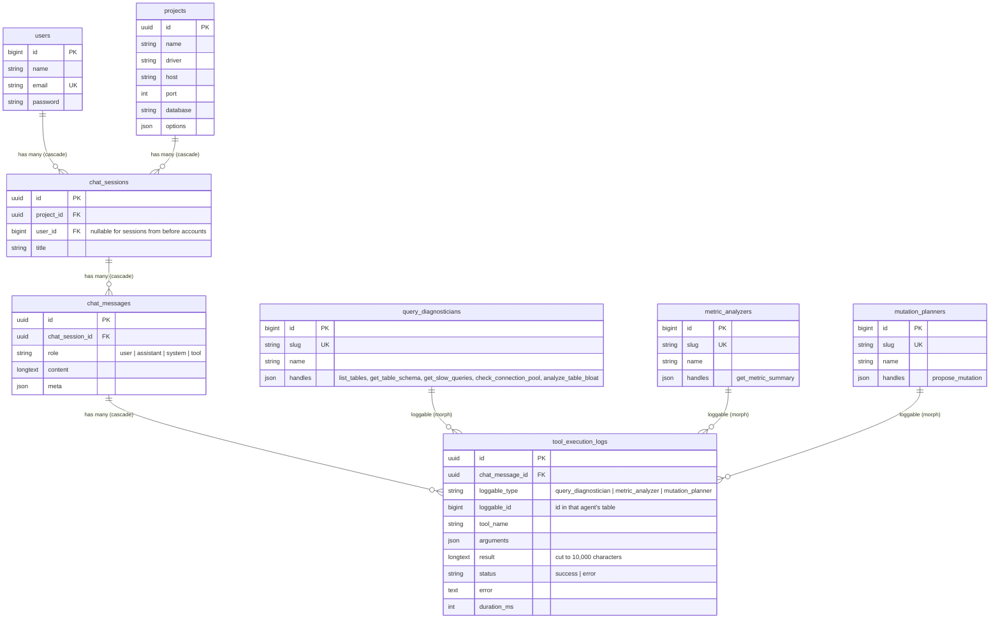

# Agentic DB Monitor

AI-assisted database monitoring and troubleshooting as a local desktop app. Chat in plain English to diagnose MySQL/PostgreSQL performance issues, let the assistant run read-only diagnostic checks automatically, and gate every write action behind explicit per-write approval.

## How it works

- **Chat** (`/chat`): ask about the active project's database. The assistant (via Prism) calls read-only diagnostic tools on its own: list tables, table schema, slow queries, connection pool, table bloat, and the telemetry summary of the active project. If the configured provider rejects function calling, the chat drops to a tool-free mode and says so.
- **Writes need approval**: the assistant can only *propose* a change. It is queued as Pending and runs only after you approve it in **Approvals** (`/approvals`). Executed, failed, and denied actions are all recorded in the action log. Proposals with more than one statement are rejected, and pending proposals expire after 24 hours.
- **Dashboard** (`/dashboard`): a KPI row, metric charts over 5m/15m/1h/6h/24h/48h, threshold breach flags (managed under **Thresholds**, `/thresholds`), and a source badge (Live or DBPA replay). For replay data a panel lists the five signals that deviate most between the anomaly and the Normal window.
- **Projects**: the sidebar switches the active project. **Kelola** edits a project's connection (an empty password keeps the stored one) or deletes it together with its chat, metrics, thresholds, and pending proposals; the audit log is kept.
- **Settings** (`/settings/ai`): choose the AI provider. The ITS LLM gateway (`https://senopati.its.ac.id/llm-gateway/v1`, model `qwen3:14b`) is the default; Ollama and OpenAI are still available. The API key is encrypted with `APP_KEY`. **Tes koneksi** checks the endpoint and reports whether it supports function calling.
- **Monitoring**: a scheduled collector records `connection_pool_used` and `slow_queries_per_min` for every active project every five minutes, evaluates enabled thresholds, and stores one database notification per breach per 15-minute cooldown.
- **Retention**: metric samples older than 48 hours are pruned hourly; `php artisan telemetry:clear` clears them on demand.

The app stores its own data in SQLite. The databases you monitor are MySQL or PostgreSQL servers, connected only while a request needs them.

## Scheduled jobs

`php artisan schedule:work` runs these; the Docker image starts it next to the web server.

| Command | Cadence | What it does |
| --- | --- | --- |
| `CollectMetrics` (job) | every 5 minutes | Connects to every active project, writes a metric sample per metric, then evaluates the project's thresholds. A failing project is logged and does not stop the other projects. |
| `approvals:expire` | every 10 minutes | Marks pending proposals older than 24 hours as `expired`. |
| `model:prune` | hourly | Deletes metric samples older than 48 hours. Configuration and the audit log are never touched. |

## Artisan commands

| Command | Purpose |
| --- | --- |
| `dbpa:import` | Loads DBPA CSV samples into a project as replay data. |
| `dbpa:benchmark` | Scores the agent against the labelled DBPA scenarios and stores an accuracy report per scenario. |
| `dbpa:recommend-thresholds` | Derives a default threshold per metric from the Normal and anomaly distributions of the dataset. |
| `telemetry:clear` | Deletes metric samples outside the 48-hour window. |
| `approvals:expire` | Expires stale pending proposals. |

## Option 1: Docker (no local PHP needed)

Requires Docker Desktop running.

```bash
docker compose up --build
```

Then open <http://localhost:8000>. To load demo data once (sample projects, metrics, chat history, pending approvals):

```powershell
$env:SEED_DEMO="true"; docker compose up --build   # PowerShell
SEED_DEMO=true docker compose up --build           # bash
```

Notes:
- The app is published on `127.0.0.1` only; it is a single-user local tool, not a network service.
- App data and the generated app key live in the `app-data` Docker volume. Reset everything with `docker compose down -v`.
- The key persisted in that volume always wins over an `APP_KEY` environment variable. Project passwords and API keys are encrypted with it, so switching keys under an existing database would make them undecryptable.
- The container runs `php artisan schedule:work` next to the web server, so collection, alerts, approval expiry, and pruning run automatically.
- From inside the container, a service on your own machine is `host.docker.internal`, not `localhost`. Use it for a local Ollama (`http://host.docker.internal:11434`) and for the host of a monitored database.

## Option 2: Local setup

Requirements:

- PHP 8.4 or newer (the locked dependencies need it; `composer.json` alone says ^8.3)
- Composer
- Node.js + npm

```bash
composer setup
php artisan db:seed    # optional demo data
composer dev
```

`composer setup` installs dependencies, creates `.env`, generates an app key, runs migrations, and builds frontend assets. `composer dev` starts the dev server.

The scheduler is not part of `composer dev`; run it in a second terminal:

```bash
php artisan schedule:work
```

## DBPA replay data (optional)

The dashboard can replay the public DBPA benchmark (`Huang et al., SIGMOD 2023`) instead of waiting for live samples:

```bash
python3 database/dbpa/convert_dbpa.py --dataset DBPA_dataset   # once, after cloning DBPA_dataset
php artisan dbpa:import --project=<project-id> --engine=pgsql --config=32_128 --scenario=lock_waits
```

Each anomalous case is preceded by a Normal segment unless `--no-normal` is passed. Re-importing replaces that project's previous telemetry, so live and replay data are never mixed in one chart, and the replay ends at the current time so the samples fall inside the 48-hour window.

The dashboard plots one card per metric key it finds, so a replay of the dataset shows all ten of its metrics (the dataset has no slow-query gauge — that one is collected live).

In Docker the CSV files are mounted read-only instead of baked into the image, so the import runs inside the container:

```bash
docker compose exec app php artisan dbpa:import --project=<project-id> --engine=pgsql --config=32_128 --scenario=lock_waits --path=/dbpa/csv
```

Two more commands work on the same dataset:

```bash
# How often does the agent name the right root cause?
php artisan dbpa:benchmark --engine=pgsql --config=32_128 --cases=3

# Which default thresholds separate Normal from anomalous traffic?
php artisan dbpa:recommend-thresholds --engine=pgsql --config=32_128
php artisan dbpa:recommend-thresholds --engine=pgsql --config=32_128 --project=<project-id> --apply
```

`dbpa:benchmark` hands the agent the metric deviations of a case and compares its answer with the scenario label; the accuracy per scenario is stored in the `benchmark_reports` table. `dbpa:recommend-thresholds` compares the Normal distribution with the anomalous one and only recommends a threshold when the two are actually separable.

## Database schema: chat and tool execution logs

Every chat session belongs to a user, every message belongs to a session, and every tool the assistant runs while writing a reply is stored as a tool execution log on that reply. Each log also points, polymorphically, to the agent that ran the tool.



| Model | Relations |
|---|---|
| `User` | `chatSessions()` hasMany `ChatSession` |
| `ChatSession` | `user()` belongsTo `User`, `project()` belongsTo `Project`, `messages()` hasMany `ChatMessage` |
| `ChatMessage` | `chatSession()` belongsTo `ChatSession`, `toolExecutionLogs()` hasMany `ToolExecutionLog` |
| `ToolExecutionLog` | `chatMessage()` belongsTo `ChatMessage`, `loggable()` morphTo the agent |
| `QueryDiagnostician`, `MetricAnalyzer`, `MutationPlanner` | `toolExecutionLogs()` morphMany `ToolExecutionLog` (shared `IsAgent` trait) |

Notes:
- **Deleting cascades in the database itself:** deleting a user, a project, a session or a message removes everything below it through the foreign keys (`cascadeOnDelete`), down to the tool logs.
- **Why `chat_message_id` stays a real foreign key next to the polymorphic `loggable`:** the two answer different questions. `chat_message_id` says *which reply* the call belongs to and is what makes cascading deletes possible; a polymorphic column cannot carry a foreign key. `loggable` (`morphs('loggable')`) says *which agent* ran the tool, so one log table serves all agent types.
- **Short type names:** `loggable_type` stores `query_diagnostician`, `metric_analyzer` or `mutation_planner` (`Relation::morphMap`), not class names.
- **Agent rows:** each agent table holds the agent's own row, inserted by its migration, and the tools it handles. A chat tool that no agent handles is an error.
- **Demo data:** `php artisan db:seed` adds, with model factories, one past conversation per demo project with tool logs from all three agents (`ChatHistorySeeder`).

### Verifying no N+1

The chat history is loaded with nested eager loading (`ChatSession::withFullHistory()`):

```php
ChatSession::query()
    ->whereBelongsTo($request->user())
    ->with('project')
    ->withFullHistory() // messages → toolExecutionLogs → loggable
    ->findOrFail($id);
```

However long the conversation, that is a fixed number of queries: the session, its project, its messages, their tool logs, and one query per agent type (at most three). `tests/Feature/ChatHistoryQueryTest.php` checks it; for 30 messages with 90 tool logs it takes the same 6 queries as for 3 messages with 3 logs, where reading the same history lazily would take 122. Outside production, `Model::preventLazyLoading()` makes any accidental lazy load fail loudly.

To see it in Laravel Debugbar (a dev dependency, active only with `APP_DEBUG=true`), run the app with its dev packages. Without a local PHP, from this folder:

```bash
# 1. PHP packages, including the dev ones (Debugbar)
docker run --rm -u "$(id -u):$(id -g)" -v "$PWD":/app -w /app composer:2 install --no-interaction

# 2. Front-end assets (they import Flux's CSS from vendor/, so after step 1)
docker run --rm -u "$(id -u):$(id -g)" -e HOME=/tmp -v "$PWD":/app -w /app node:22-alpine \
  sh -c 'npm ci --no-audit --no-fund && npm run build'

# 3. The app with demo data on http://localhost:8001
#    (its own database file and a throwaway app key; your .env is not used)
docker run --rm -it -p 127.0.0.1:8001:8000 -v "$PWD":/app -w /app \
  -e HOST_IDS="$(id -u):$(id -g)" -e APP_ENV=local -e APP_DEBUG=true \
  -e APP_KEY="base64:$(head -c 32 /dev/urandom | base64)" \
  -e DB_CONNECTION=sqlite -e DB_DATABASE=/app/database/debugbar.sqlite \
  php:8.4-cli sh -c '
    own() { chown -R "$HOST_IDS" database/debugbar.sqlite storage bootstrap/cache; }
    touch database/debugbar.sqlite
    php artisan migrate:fresh --seed --force || { own; exit 1; }
    php artisan serve --host=0.0.0.0 --port=8000 & pid=$!
    trap "kill $pid 2>/dev/null; wait $pid; own; exit 0" INT TERM
    wait $pid; own'
```

Then:

1. Open <http://localhost:8001> and log in as `admin@example.com` / `password`.
2. Open **Chat diagnostik → Riwayat** and open (**Buka**) a conversation with **12** messages from 2 days ago. That is the seeded one, with 18 tool logs from all three agents.
3. Open the Debugbar **Queries** tab. The history adds 7 queries (`chat_sessions`, `projects`, `chat_messages`, `tool_execution_logs` and the three agent tables), each with `where … in (…)`, and none per message or per log. The rest of the count is login and the page layout. One layout query, the project list, runs twice because two layout components load it; it does not grow with the conversation.

<!-- Debugbar screenshot of the Queries tab on the chat history page: -->
<!--  -->

Stop it with Ctrl+C. Everything these steps create is ignored by git (`vendor/`, `node_modules/`, `public/build/`, `database/debugbar.sqlite`, files under `storage/`) and stays owned by your user.

## Tests

```bash
composer test
php artisan test --compact --filter=testName
```

## Docs

Design documents are in `docs/`: high-level design, ERD, user stories, naming conventions, and per-flow activity and sequence diagrams.
