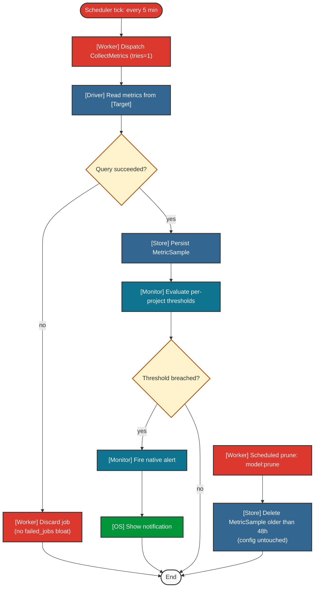

# Monitoring & Retention — UC-07, UC-08

Legend: see [`README.md`](./README.md).

See also: [`configuration.md`](./configuration.md).

## Notes

- Trigger: scheduled every 5 min; job runs with `tries=1`.
- Failure semantics: a failed collect is discarded, not retried (avoids `failed_jobs` bloat).
- Thresholds are evaluated per-project.
- Retention: samples older than 48h are pruned; configuration/profiles are never pruned.
- Postcondition: a breach raises a native OS notification.
