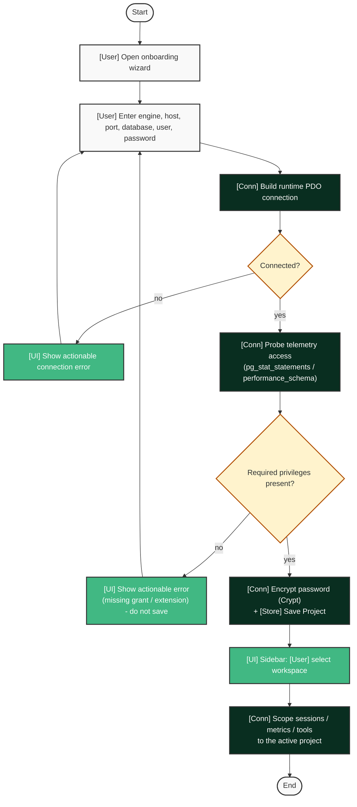

# Onboarding & Credentials — UC-01, UC-02

Legend: see [`README.md`](./README.md).

See also: [`ai_diagnostics.md`](./ai_diagnostics.md).

## Notes

- Precondition: none — this is the first-run flow.
- Connection is validated and telemetry privileges probed *before* the project is saved; failures never persist.
- Password is encrypted via `Crypt` into SQLite, never written to `.env`.
- Postcondition: sessions/metrics/tools are scoped strictly to the active project.
