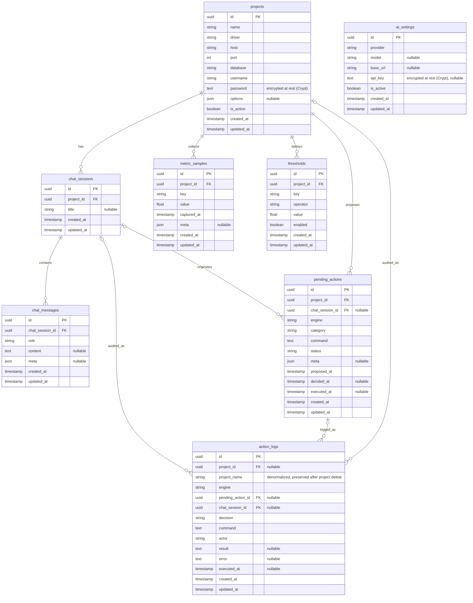

# Entity Relationship Diagram — Agentic DB Monitor

Local SQLite store, Crow's foot notation. The default Laravel tables (`users`,
`password_reset_tokens`, `sessions`, `cache`, `jobs`) are untouched system tables and are
excluded. All PKs are UUID v7 (`char(36)`, `HasUuids`); foreign keys are `foreignUuid`.

## How to read Crow's foot

| Symbol | Meaning |
| --- | --- |
| `||` | Exactly one |
| `|o` | Zero or one (optional) |
| `o{` | Zero or many |
| `||--o{` | One-to-many (parent owns many children) |
| `|o--o{` | Optional parent, many children (FK nullable) |

## Notes

- `ai_settings` is a standalone singleton (no FK) — UC-09 provider config.
- **Cascade with project delete:** `chat_sessions`, `chat_messages`, `pending_actions`,
  `metric_samples`, `thresholds`.
- **Preserved on project delete:** `action_logs` keeps its rows with `project_id` set to
  `NULL` and a denormalized `project_name`/`engine` so the audit trail stays readable
  (append-only).
- `pending_actions.chat_session_id`, `action_logs.project_id`/`pending_action_id`/
  `chat_session_id` are optional (`nullOnDelete`).
- `metric_samples` implements the `Prunable` contract (48h cutoff); configuration is never pruned.

See also: [`high_level_design.md`](./high_level_design.md), [`implementation_plan.md`](./implementation_plan.md) § 3,
[`naming_conventions.md`](./naming_conventions.md).