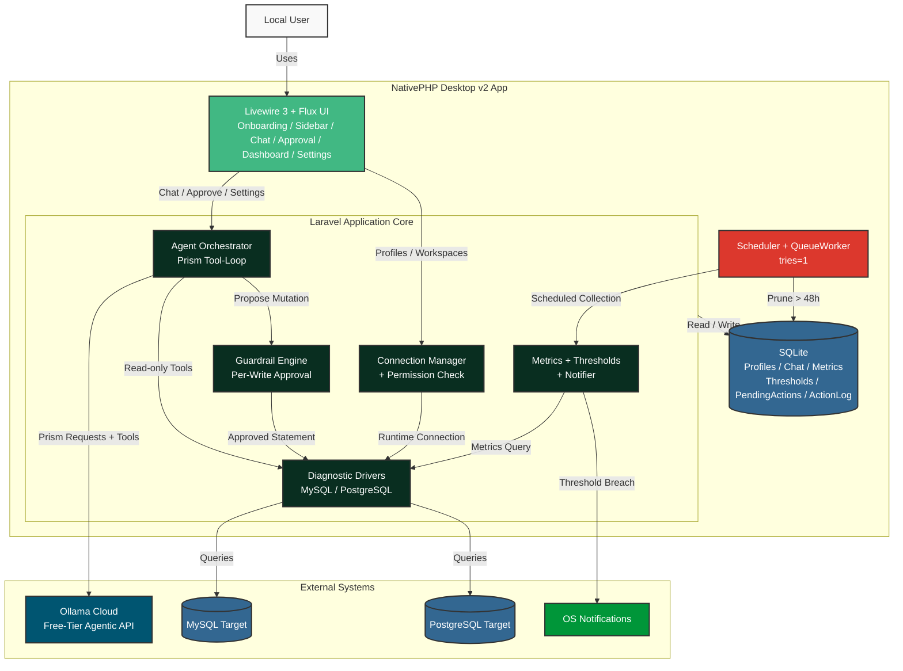

# Agentic DB Monitor High-Level Design (HLD)

## Current Architecture Topology

This diagram outlines the runtime topology of the Agentic DB Monitor desktop application: a single-user, local NativePHP Desktop v2 app whose Laravel core orchestrates an AI diagnostic loop against target MySQL/PostgreSQL databases. The interface is built with Livewire 3 and the free Flux UI component library.

