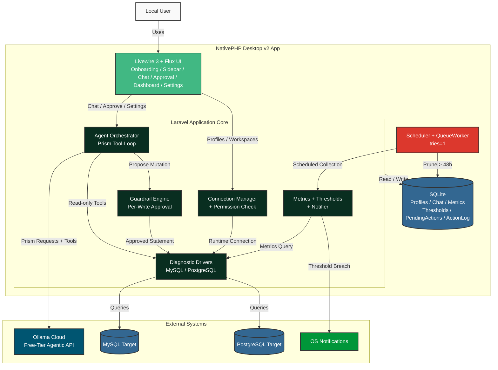

# Agentic DB Monitor High-Level Design (HLD)

## Current Architecture Topology

This diagram outlines the runtime topology of the Agentic DB Monitor desktop application: a single-user, local NativePHP Desktop v2 app whose Laravel core orchestrates an AI diagnostic loop against target MySQL/PostgreSQL databases. The interface is built with Livewire 3 and the free Flux UI component library.

## Description Notes

**Runtime model.** The application is a single-user, local NativePHP Desktop v2 app. It runs entirely on the user's machine with no server component and no authentication; every piece of state (credentials, chat history, telemetry, audit trail) stays local.

**Presentation.** The `Livewire 3 + Flux UI` node is the whole interface, built from Flux components: onboarding wizard, workspace sidebar, diagnostics chat (streamed tokens), approval modal, health dashboard, and settings.

**Laravel Application Core.** Business logic is grouped into five services:
- *Agent Orchestrator* — owns the Prism tool-loop, the system prompt, and token streaming to the chat.
- *Guardrail Engine* — classifies proposed statements and holds mutating actions for per-write approval.
- *Connection Manager (+ Permission Check)* — decrypts project credentials, registers a runtime connection per project, and verifies telemetry read privileges on save.
- *Diagnostic Drivers* — the per-engine (MySQL / PostgreSQL) gateway for every target query; the only path to a target database.
- *Metrics + Thresholds + Notifier* — evaluates per-project thresholds and raises native alerts.

**Background worker.** `Scheduler + QueueWorker` runs the 5-minute metrics poll and scheduled pruning, with `--tries=1` so failed external connections are discarded rather than accumulating.

**Local store.** A single SQLite database holds profiles, chat, metrics, thresholds, pending actions, and the audit log. All reads/writes are collapsed to one `Core --> SQLite` edge in the diagram; retention prunes raw samples older than 48h without touching configuration.

**External systems.**
- *Ollama Cloud* — the default free-tier agentic API reached through Prism.
- *MySQL / PostgreSQL Targets* — the monitored databases, reached only through the Diagnostic Drivers.
- *OS Notifications* — native desktop alerts fired on threshold breach.

**Key flows.**
- *Ask & approve:* `UI → Agent`; the Agent calls read-only tools through the Drivers, and any mutation is proposed to the Guardrail Engine, which halts the loop for approval before the Driver executes it.
- *Monitor:* the Worker triggers metric collection and threshold evaluation; a breach produces an OS notification.
- *Persist:* chat, profiles, metrics, and the audit trail are written to the local SQLite store through the Core.

See also: [`entity_relationship_diagram.md`](./entity_relationship_diagram.md),
[`implementation_plan.md`](./implementation_plan.md) § 3.
