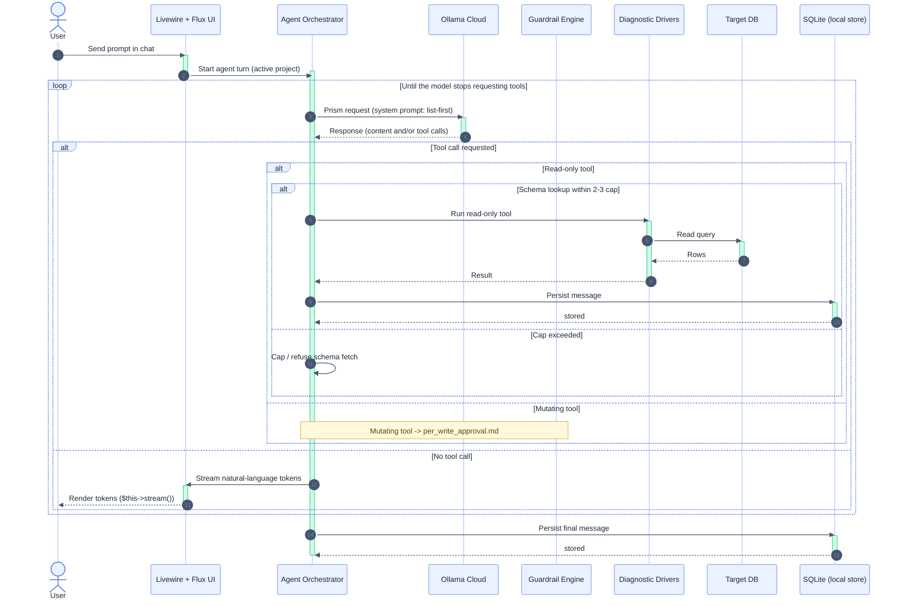

# AI Diagnostics (read-only) — UC-03, UC-04, UC-05

Participants: see [`README.md`](./README.md).

The mutating branch is defined in [`per_write_approval.md`](./per_write_approval.md); it is
marked below with a handoff note (Mermaid's `ref` fragment is unsupported in current versions).

See also: activity counterpart [`../activity_diagram/ai_diagnostics.md`](../activity_diagram/ai_diagnostics.md).

## Notes

- Precondition: active project with a healthy connection and a configured provider key.
- Invariant: read-only tools auto-run; the Guardrail Engine is reached only for mutations.
- Rule: schema lookups capped at 2–3 calls per turn to bound context.
- Prompt-enforced: "list-first" and tool choice are prompted (Ollama has no required-tools) and there is no native JSON mode.
- Postcondition: results appended to Prism context and the message persisted.
