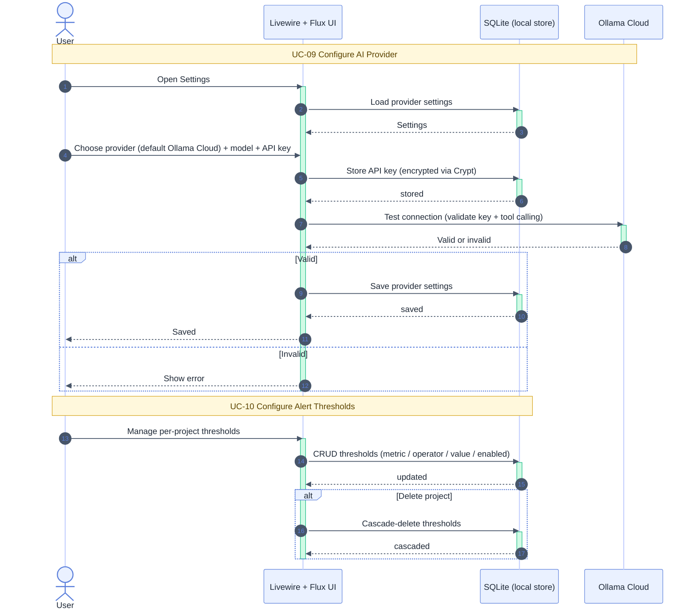

# Configuration — UC-09, UC-10

Participants: see [`README.md`](./README.md).

See also: activity counterpart [`../activity_diagram/configuration.md`](../activity_diagram/configuration.md),
[`monitoring_and_retention.md`](./monitoring_and_retention.md).

## Notes

- UC-09: provider defaults to Ollama Cloud; the model must be tool-capable; the key is encrypted at rest (never `.env`).
- Test connection validates both key validity and tool-calling support before saving.
- UC-10: thresholds are strictly project-scoped; deleting a project cascades to its thresholds.
- Postcondition: the poller evaluates only the active project's thresholds.
