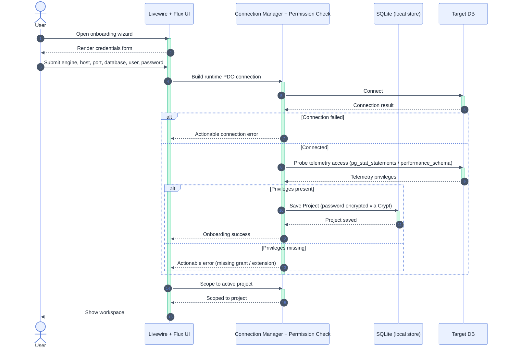

# Onboarding & Credentials — UC-01, UC-02

Participants: see [`README.md`](./README.md).

See also: activity counterpart [`../activity_diagram/onboarding_and_credentials.md`](../activity_diagram/onboarding_and_credentials.md).

## Notes

- Precondition: none — this is the first-run flow.
- Connection is validated and telemetry privileges probed *before* the project is saved; failures never persist.
- Password is encrypted via `Crypt` into SQLite, never written to `.env`.
- On any failure the flow returns to credential entry (retry loop) without saving.
- Postcondition: sessions/metrics/tools are scoped strictly to the active project.
