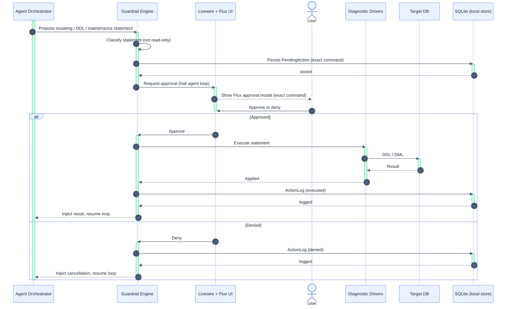

# Guardrails: Per-Write Approval — UC-06

Participants: see [`README.md`](./README.md).

See also: activity counterpart [`../activity_diagram/per_write_approval.md`](../activity_diagram/per_write_approval.md),
[`ai_diagnostics.md`](./ai_diagnostics.md).

## Notes

- Precondition: reached only from an agent tool call classified as non-read-only.
- Invariant: no session-level bypass — every mutation is approved individually.
- `PendingAction` (exact command) is persisted before the halt; the command is shown verbatim.
- Deny path injects a cancellation notice so the agent adapts without executing.
- Postcondition: every decision (executed/denied) is written to `ActionLog`.
